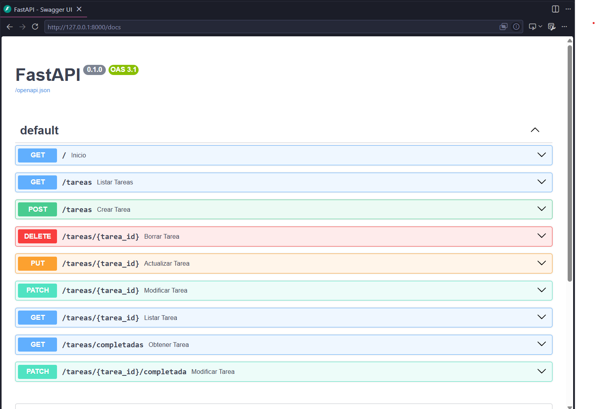

# ✅ API de Tareas

API REST para gestionar tareas, construida con FastAPI y SQLite.




## ✨ Características

- CRUD completo de tareas (crear, listar, obtener, reemplazar, modificar y eliminar)
- Validación automática de datos con Pydantic
- Manejo de errores con códigos HTTP correctos (404, 422)
- Persistencia en una base de datos SQLite
- Documentación interactiva generada automáticamente

## 🚀 Instalación

```bash
# 1. Crea y activa un entorno virtual
python -m venv venv
venv\Scripts\activate

# 2. Instala las dependencias
python -m pip install -r requirements.txt
```

## ▶️ Ejecución

```bash
python -m uvicorn main:app --reload
```

La documentación interactiva queda en http://127.0.0.1:8000/docs

## 📚 Endpoints

| Método | Ruta | Descripción |
|--------|------|-------------|
| `GET` | `/tareas` | Lista todas las tareas |
| `GET` | `/tareas/{id}` | Obtiene una tarea |
| `POST` | `/tareas` | Crea una tarea |
| `PUT` | `/tareas/{id}` | Reemplaza una tarea completa |
| `PATCH` | `/tareas/{id}` | Modifica solo los campos enviados |
| `DELETE` | `/tareas/{id}` | Elimina una tarea |

## 📝 Ejemplo

```json
{
  "titulo": "Estudiar FastAPI",
  "descripcion": "Terminar el CRUD",
  "completada": false
}
```

## 🗺️ Próximos pasos

- [ ] Reorganizar el código en módulos
- [ ] Migrar a SQLAlchemy
- [ ] Agregar pruebas con pytest
- [ ] Autenticación de usuarios

